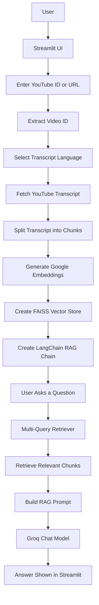
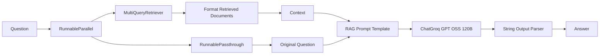

# YouTube Video AI Chatbot

An AI-powered chatbot built with Streamlit and LangChain that lets you chat with the transcript of a YouTube video.

## Features

- Accepts a YouTube video ID or YouTube URL
- Supports transcripts in 11 languages
- Splits transcripts into searchable text chunks
- Uses Google embeddings and FAISS similarity search
- Uses Groq-hosted `openai/gpt-oss-120b` through LangChain
- Generates multi-query searches for better retrieval
- Answers strictly from the selected video's transcript
- Includes a Docker setup for running the application

## Project Flow Chart



## Chain Graph



## Installation

### 1. Requirements

- Python 3.13 is recommended
- Docker and Docker Compose, optional
- A Groq API key
- A Google API key with Gemini embedding access

### 2. Clone the Project

```bash
git clone <repository-url>
cd youtube_chat
```

### 3. Create and Activate a Virtual Environment

Windows PowerShell:

```powershell
python -m venv .venv
.venv\Scripts\Activate.ps1
```

If script execution is disabled, run:

```powershell
Set-ExecutionPolicy -Scope Process -ExecutionPolicy Bypass
.venv\Scripts\Activate.ps1
```

macOS or Linux:

```bash
python3 -m venv .venv
source .venv/bin/activate
```

### 4. Install Dependencies

```bash
python -m pip install --upgrade pip
python -m pip install -r requirements.txt
```

### 5. Configure API Keys

Create a `.env` file in the project root:

```env
GROQ_API_KEY=your_groq_api_key
GOOGLE_API_KEY=your_google_api_key
```

Use `GOOGLE_API_KEY` for the Google Generative AI embeddings integration.

## Run the Application

```bash
streamlit run main.py
```

Open the local URL shown in the terminal, usually:

```text
http://localhost:8501
```

## Using the App

1. Enter a YouTube video ID or URL in the sidebar.
2. Select the transcript language.
3. Click **Process Video**.
4. Ask a question in the chat area.
5. The response will be generated only from the video's transcript.

The app accepts normal YouTube URLs, short URLs, embed URLs, Shorts URLs, and direct video IDs.

## Docker Installation

Make sure Docker Compose and your `.env` file are configured.

Build and run:

```bash
docker compose up --build
```

Open:

```text
http://localhost:8501
```

Stop the containers:

```bash
docker compose down
```

## Draw.io Diagrams

The editable architecture diagrams are included in:

- `project_flow_chart.drawio`
- `chain_graph.drawio`

Open them with [draw.io](https://app.diagrams.net/) or the VS Code Draw.io extension.

## Project Structure

```text
youtube_chat/
├── main.py
├── config/
│   └── settings.py
├── services/
│   ├── chain.py
│   ├── embeddings.py
│   ├── llm.py
│   ├── retriever.py
│   ├── transcript.py
│   └── vector_store.py
├── ui/
│   ├── chat.py
│   ├── sidebar.py
│   └── video.py
└── utils/
    └── youtube.py
```

## Security Note

Never commit real API keys to source control. Keep `.env` local and replace any previously exposed credentials.
